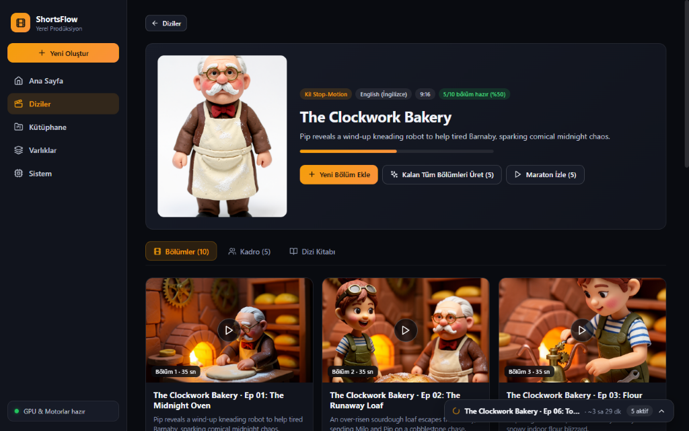
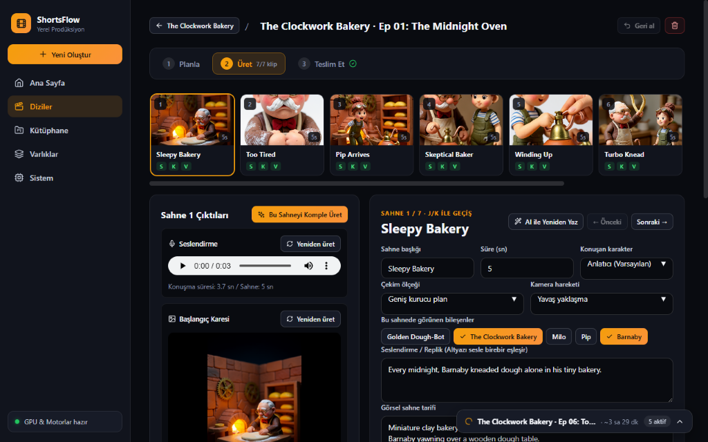
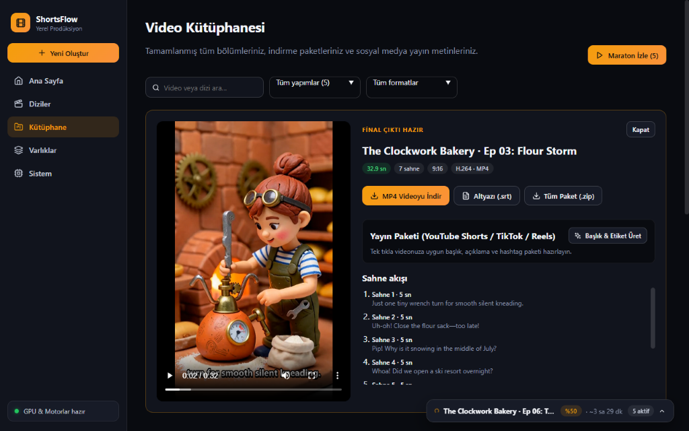
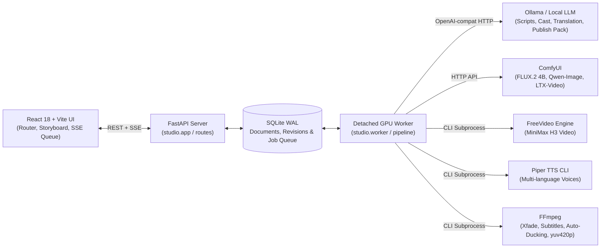

<div align="center">

# ShortsFlow

### Local-First AI Animation & Short-Form Series Production Studio

Turn a story idea into multi-episode animated shorts with consistent characters & locations, multi-speaker dialogue, 1-to-1 voice-synced subtitles, auto-ducking music, and publish-ready exports — **running 100% locally on an 8 GB VRAM GPU**.

[](./LICENSE)
[](https://www.python.org/)
[](https://fastapi.tiangolo.com/)
[](https://react.dev/)
[](#hardware--quality-profiles)

[Features](#key-features) •
[Screenshots](#interface-preview) •
[Architecture](#architecture) •
[Quick Start](#quick-start) •
[Quality Profiles](#hardware--quality-profiles) •
[Model Licenses](#third-party-engine--model-licenses) •
[Roadmap](#roadmap)

<br />



</div>

---

## Why ShortsFlow?

Most local AI video tools stop at generating a single 5-second clip from a prompt. Producing an actual **short film or episodic series** requires far more: consistent characters and locations across shots, distinct voices for dialogue, captions locked to spoken timing, background music that ducks during speech, resilient GPU memory management, and a sane editing workflow.

**ShortsFlow** bridges that gap by combining a full studio UI (`Series → Episode → Scene`) with a resilient, SQLite-backed local GPU production pipeline — with **zero cloud API costs** and **full ownership** of your projects and media.

<details>
<summary><strong>Türkçe Özet için tıklayın</strong></summary>

<br />

**ShortsFlow**, yalnızca 8 GB VRAM ve 16 GB RAM’e sahip yerel bilgisayarlarda çok bölümlü kısa animasyon dizileri, tutarlı karakter/mekan kadroları, çok karakterli diyaloglar, sesle 1-1 eşleşen altyazılar ve yayına hazır YouTube Shorts / Reels / TikTok videoları üretmenizi sağlayan **Apache-2.0** lisanslı açık kaynaklı bir prodüksiyon stüdyosudur. Bulut API ücreti olmadan tamamen yerel modellerle (Ollama, ComfyUI, FreeVideo, Piper CLI, FFmpeg) çalışır.

</details>

---

## Interface Preview

### 1. 3-Stage Episode Workspace & Visual Storyboard
Plan scripts, inspect a horizontal visual storyboard with per-stage readiness indicators (`Audio · Frame · Clip`), switch alternate takes, detect stale assets when text changes, and navigate scenes with keyboard shortcuts (`J` / `K`, `Ctrl+Z` undo, debounced auto-save).

<p align="center">
  
</p>

### 2. Video Library, Delivery Theater & Publish Pack
Browse all completed episodes by series or aspect ratio, binge-watch sequentially with **Marathon Watch**, download `MP4` / `SRT` / full `.zip` bundles, and generate YouTube Shorts / TikTok / Reels titles, hooks, descriptions, and hashtags with one click.

<p align="center">
  
</p>

---

## Key Features

### Production Hierarchy & Series Bible
- **`Series → Episode → Scene` Organization:** Group multi-episode shows under a unified **Series Hub** with progress tracking, episode grids, cast roster, and sequential **Marathon Watch**.
- **Inherited Series Bible:** Configure visual style, aspect ratio (`9:16`, `16:9`, `1:1`), language, narrator voice, transition style, caption preset, and background music once — every new episode inherits them automatically.
- **5-Step Creation Wizard:** Guided creation flow from story idea → interactive 20-second style previews → AI cast & location proposals → format & quality selection → live time & disk estimates.

### Visual Consistency & Multi-Character Dialogue
- **Reusable Ingredients (Characters, Locations & Props):** Generate or upload reference sheets once and link them to one or more series. ShortsFlow passes references directly into diffusion conditioning (`ReferenceLatent` / `FreeVideo` references) for visual continuity.
- **Per-Character Voices:** Assign distinct local TTS voices to each character so multi-character scenes play out as real dialogue.
- **Automatic English Prompt Translation:** Write briefs, scripts, and visual descriptions in Turkish (or other languages) — ShortsFlow transparently translates visual & motion prompts into clean English for diffusion models while keeping voiceover and subtitles in your target language.

### Editing, Delivery & Resilience
- **1-to-1 Voice-Synced Subtitles:** Captions split dynamically at natural punctuation boundaries, match exact spoken WAV durations, and burn into the lower safe zone (`yuv420p` H.264 for universal browser & mobile playback).
- **Royalty-Free Synthesized BGM + Auto-Ducking:** Built-in ambient music presets (or custom MP3/WAV uploads) mixed with FFmpeg sidechain compression so music ducks smoothly underneath narration.
- **Stale Asset Detection & Alternate Takes:** Content hashing flags when edited dialogue or visual prompts outdate existing audio/frames; every regeneration keeps prior takes selectable right inside the scene editor.
- **Persistent SSE Queue & System Telemetry:** Bottom-right live production queue with ETA estimates, priority bump, cancel/retry, humanized error recovery, 1-click local service launch, and live GPU VRAM / RAM / Disk monitoring.

---

## Architecture

ShortsFlow is a lightweight, self-contained **FastAPI + React** application that orchestrates external local AI engines out-of-process — keeping the core codebase clean, modular, and strictly **Apache-2.0**.



---

## Hardware & Quality Profiles

ShortsFlow is **Bring Your Own Models (BYOM)** — no model weights are bundled in this repository. It is engineered and tested for consumer GPUs with **8 GB VRAM and 16 GB system RAM** (tested on **NVIDIA GeForce RTX 5060**), automatically releasing VRAM between LLM, image, and video stages.

| Quality Profile | Image Model | Video Model | Est. Speed *(8 GB VRAM)* | Best For |
|---|---|---|---|---|
| **Fast (Draft)** | FLUX.2 `[klein]` 4B FP8 | LTX-Video 0.9.8 Distilled FP8 | ~1.5–2 min / scene | Rapid iteration & storyboarding |
| **Balanced *(Recommended)*** | FLUX.2 `[klein]` 4B FP8 | MiniMax H3 INT8 *(FreeVideo + step-cache)* | ~3.5 min / scene | Episodic series & high motion fidelity |
| **High (Cinematic)** | Qwen-Image-2.1 Turbo INT8 | MiniMax H3 INT8 *(FreeVideo + step-cache)* | ~12 min / scene | Maximum detail hero shots |
| **Still Motion** | Any image model | FFmpeg Ken Burns motion | ~30 sec / scene | Explainers & ultra-fast drafts |

---

## Quick Start

### 1. Prerequisites

| Requirement | Notes |
|---|---|
| **Python 3.11+** | Backend API & GPU worker |
| **Node.js 18+** | Frontend build (Vite + React 18) |
| **FFmpeg & FFprobe** | Must be available on system `PATH` |
| **[Ollama](https://ollama.com/)** | Local LLM server (e.g. `ollama pull qwen3-vl:8b-instruct`) |
| **[ComfyUI](https://github.com/comfyanonymous/ComfyUI)** | Local image & LTX-Video server (`http://127.0.0.1:8188`) |
| **Piper CLI** *(optional)* | External local TTS executable (`STUDIO_PIPER_BIN` or on `PATH`) |
| **[FreeVideo](https://github.com/FlashML-org/FreeVideo)** *(optional)* | Local MiniMax H3 video generation engine |

### 2. Clone & Configure Backend

```bash
git clone https://github.com/DenizEryilmaz/ShortsFlow.git
cd ShortsFlow

python -m venv .venv

# Windows (PowerShell):
.\.venv\Scripts\Activate.ps1
# Linux / macOS:
# source .venv/bin/activate

pip install -r requirements.txt
cp .env.example .env
```

Edit `.env` to point to your local ComfyUI, Ollama, and optional FreeVideo / Piper installations:

| Variable | Default | Description |
|---|---|---|
| `STUDIO_HOST` | `127.0.0.1` | Bind host for FastAPI server |
| `STUDIO_PORT` | `8010` | Port for Web UI and API |
| `STUDIO_DATA_DIR` | `./data` | Directory for SQLite DB, uploaded assets, caches, and rendered jobs |
| `STUDIO_LLM_BASE_URL` | `http://127.0.0.1:11434/v1` | OpenAI-compatible local LLM endpoint |
| `STUDIO_LLM_MODEL` | `qwen3-vl:8b-instruct` | Default LLM for scriptwriting, translation, cast & publish packs |
| `STUDIO_COMFY_URL` | `http://127.0.0.1:8188` | Running ComfyUI server URL |
| `STUDIO_COMFY_ROOT` | `../ComfyUI-local` | Path to local ComfyUI folder (for model discovery & 1-click start) |
| `STUDIO_FREEVIDEO_ROOT` | `../FreeVideo-local` | Optional path to local FreeVideo installation |
| `STUDIO_PIPER_BIN` | `piper` | Optional path to external Piper TTS CLI executable |

### 3. Build Frontend & Launch

```bash
cd frontend
npm install
npm run build
cd ..

python -m studio.app
```

Open **[http://127.0.0.1:8010](http://127.0.0.1:8010)** in your browser.

### 4. Development Mode & Tests

```bash
# Run backend test suite (21 unit & integration tests)
pytest -v

# Run frontend with Vite hot reload (proxies /api to :8010)
cd frontend && npm run dev
```

---

## Project Structure

```text
ShortsFlow/
├── studio/                     # FastAPI backend & local GPU production pipeline
│   ├── app.py                  # Standalone FastAPI entrypoint & SPA static serving
│   ├── routes.py               # REST API + SSE (/api/studio/events/stream)
│   ├── schema.py               # Pydantic v2 models (Series, Project, Scene, Character)
│   ├── store.py                # SQLite WAL store, revisions, queue & series migration
│   ├── worker.py               # Detached background GPU job runner
│   ├── pipeline.py             # Staged generation, takes, subtitles, BGM & FFmpeg render
│   ├── providers.py            # ComfyUI, FreeVideo, FFmpeg & VRAM lifecycle adapters
│   ├── llm.py                  # OpenAI-compatible structured JSON LLM client
│   ├── media.py                # Out-of-process Piper CLI TTS, BGM synth & style presets
│   ├── models.py               # Installed engine/model discovery & voice registry
│   ├── style_examples.py       # 8 curated visual styles + 20s TR/EN demo generator
│   └── system_info.py          # Service health, GPU/RAM/Disk telemetry & cache tools
├── frontend/                   # React 18 + React Router + Vite Studio UI
│   └── src/
│       ├── components/         # AppShell, QueueDrawer, DeliveryTheater, UI Primitives
│       ├── context/            # StudioContext (state, SSE stream, notifications)
│       ├── pages/              # Home, SeriesList, SeriesHub, EpisodeWorkspace,
│       │                       # Wizard, Library, Assets, System
│       └── styles/studio.css   # Unified dark-studio design system
├── tests/                      # Automated backend test suite
├── docs/screenshots/           # README preview screenshots
├── .env.example                # Environment configuration template
├── requirements.txt            # Core Apache/MIT/BSD Python dependencies
└── LICENSE                     # Apache License 2.0
```

---

## Third-Party Engine & Model Licenses

ShortsFlow itself is licensed under the **Apache License 2.0** ([LICENSE](./LICENSE)).  
This repository **does not include or redistribute** any third-party engines, AI model weights, or voice checkpoints. When you download and run external engines or models locally, **you are solely responsible for complying with their respective licenses**:

| Component | Integration Mode | License | Key Terms & Notes |
|---|---|---|---|
| **ShortsFlow** *(this repo)* | Core codebase | **Apache-2.0** | Permissive open source |
| **Ollama** | External HTTP API | MIT | Separate local server |
| **ComfyUI** | External HTTP API | GPL-3.0 | Separate local server |
| **FreeVideo** *(engine code)* | External CLI subprocess | Apache-2.0 | Separate local installation |
| **FFmpeg** | External CLI subprocess | LGPL / GPL | System binary |
| **Piper TTS** | External CLI subprocess | GPL-3.0-or-later | Invoked strictly out-of-process via CLI (`STUDIO_PIPER_BIN`) |
| **Qwen3-VL-8B-Instruct** | Model weights *(user-supplied)* | **Apache-2.0** | Commercial & open-source friendly |
| **FLUX.2 `[klein]` 4B** | Model weights *(user-supplied)* | **Apache-2.0** | Commercial & open-source friendly *(9B / dev variants are non-commercial)* |
| **LTX-Video 0.9.8** | Model weights *(user-supplied)* | LTX Open Weights / Community | Commercial free under revenue cap; review Lightricks terms |
| **MiniMax H3** | Model weights *(user-supplied)* | MiniMax H3 Community License | Revenue cap, UI attribution, and territorial restrictions (US/EU/UK/KR) — review MiniMax terms before commercial use |
| **Qwen-Image-2.1** | Model weights *(user-supplied)* | Qwen Research License | **Non-commercial** research/evaluation license for weights |
| **Piper Voices** (`rhasspy/piper-voices`) | Voice checkpoints *(user-downloaded)* | Per-voice `MODEL_CARD` | Licenses vary per voice dataset (CC0, CC-BY, research-only); inspect each voice's `MODEL_CARD` on Hugging Face |

---

## Roadmap

- [ ] Full English / Turkish UI locale switcher (currently UI defaults to Turkish with multilingual content output)
- [ ] Optional Docker Compose setup for Linux GPU hosts
- [ ] Additional open-source TTS backends (Kokoro / Chatterbox)
- [ ] Scene-level timeline waveform scrubbing & custom subtitle font/position controls
- [ ] Automated social publishing integrations (YouTube Data API draft upload)

---

## Contributing

Contributions, bug reports, and feature ideas are warmly welcome!

1. Fork the repository and create a feature branch (`git checkout -b feat/my-feature`).
2. Run tests (`pytest -v`) and verify the frontend build (`cd frontend && npm run build`).
3. Open a Pull Request describing your changes clearly.

---

## License

Copyright © 2026 **Deniz Eryilmaz**.  
Licensed under the **Apache License, Version 2.0** — see the [LICENSE](./LICENSE) file for full details.
